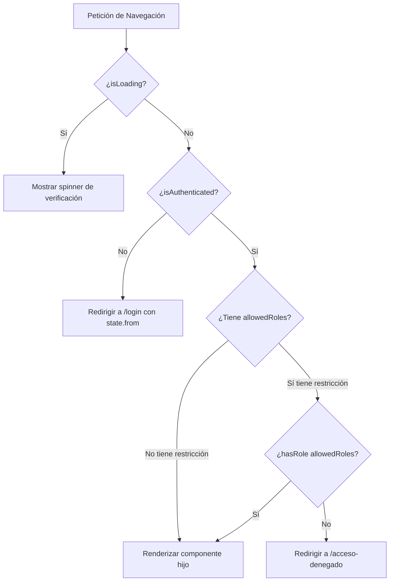

# BIO-32: Implementación de Pantalla de Inicio de Sesión y Protección de Rutas en React

## 1. Objetivo de la Subtarea
Desarrollar y validar en el frontend (React + Vite + React Router) la pantalla de autenticación y el mecanismo completo de protección de rutas basado en roles (`ADMINISTRADORA` y `TRABAJADORA`), correspondiente a la subtarea **BIO-32** de la historia de usuario **HU-02 (BIO-6): Inicio y cierre de sesión con control de acceso por rol** para el sistema de **Botica Biofarma**.

Objetivos técnicos alcanzados:
1. Diseñar e implementar la pantalla interactiva y responsive de inicio de sesión (`LoginPage.jsx`).
2. Centralizar los llamados a la API de autenticación (`authApi.js`) con Axios y el cliente HTTP configurable.
3. Completar el contexto de autenticación (`AuthContext.jsx`) con persistencia segura en `localStorage`, validación de expiración de token en cliente y gestión del estado reactivo de sesión.
4. Implementar el layout autenticado (`AppLayout.jsx`) con navegación condicional que oculta elementos administrativos a usuarias con rol `TRABAJADORA`.
5. Proteger las rutas privadas mediante `ProtectedRoute.jsx`, eliminando el bypass temporal `requireAuth={false}` de la HU-01 y redirigiendo intentos no autorizados a login (`/login`) o acceso restringido (`/acceso-denegado`).
6. Implementar el flujo de cierre de sesión seguro con invalidación local inmediata garantizada.

---

## 2. Estado Inicial del Frontend
Antes de iniciar BIO-32:
- **HU-01:** Contaba únicamente con `UsuariosPage.jsx` para el registro y listado de usuarios.
- **Rutas:** `App.jsx` montaba `/usuarios` con `<ProtectedRoute requireAuth={false}>`, permitiendo acceso público temporal sin autenticación.
- **Contexto:** `AuthContext.jsx` tenía funciones mínimas sin llamadas reales a la API de login ni validación de expiración de token.
- **Dependencias:** `node_modules` no se encontraba instalado en el entorno de desarrollo local.
- **Vistas:** No existían la pantalla de login, el layout principal de navegación, la página de inicio post-login ni la vista de acceso restringido (403).

---

## 3. Componentes Reutilizados
- **`httpClient.js`:** Cliente Axios centralizado con interceptores para inyección automática de la cabecera `Authorization: Bearer <token>` y captura de errores HTTP normalizados.
- **`useAuth.js`:** Hook personalizado para consumo simplificado del contexto de autenticación en cualquier componente.
- **`UsuariosPage.jsx` y `UsuariosPage.css`:** Módulo completo de gestión de usuarios desarrollado en HU-01, ahora protegido bajo rol `ADMINISTRADORA`.
- **Iconos de `lucide-react`:** Iconografía estándar (`Pill`, `Shield`, `ShieldAlert`, `Users`, `LogOut`, `Home`, `Eye`, `EyeOff`, `Lock`, `AlertCircle`, `CheckCircle2`, `Loader2`).

---

## 4. Archivos Creados y Modificados

### A. Archivos Creados
1. [authApi.js](file:///c:/Users/Erick/Desktop/Botica_Miofarma/botica-biofarma/frontend/src/api/authApi.js):
   - Funciones `login({ codigoUsuario, password })` y `logout()`.
2. [LoginPage.jsx](file:///c:/Users/Erick/Desktop/Botica_Miofarma/botica-biofarma/frontend/src/pages/auth/LoginPage.jsx):
   - Formulario accesible con código de usuario, contraseña, conmutador de visibilidad (show/hide), validación de campos obligatorios, estado de carga y prevención de doble envío.
3. [LoginPage.css](file:///c:/Users/Erick/Desktop/Botica_Miofarma/botica-biofarma/frontend/src/pages/auth/LoginPage.css):
   - Estilizado profesional con identidad visual de Botica Biofarma, paleta de colores corporativa (`#0f766e`), sombras suaves y diseño responsive.
4. [AppLayout.jsx](file:///c:/Users/Erick/Desktop/Botica_Miofarma/botica-biofarma/frontend/src/components/layout/AppLayout.jsx):
   - Barra de navegación persistente con marca, enlaces según rol, chip de usuario autenticado con badge de rol (`ADMINISTRADORA` o `TRABAJADORA`) y botón de cerrar sesión.
5. [AppLayout.css](file:///c:/Users/Erick/Desktop/Botica_Miofarma/botica-biofarma/frontend/src/components/layout/AppLayout.css):
   - Estilos de cabecera fija, badges diferenciados por rol y adaptabilidad móvil.
6. [InicioPage.jsx](file:///c:/Users/Erick/Desktop/Botica_Miofarma/botica-biofarma/frontend/src/pages/dashboard/InicioPage.jsx):
   - Página principal post-login (`/inicio`) con bienvenida personalizada, fecha formateada y tarjetas de navegación/información según el rol activo.
7. [InicioPage.css](file:///c:/Users/Erick/Desktop/Botica_Miofarma/botica-biofarma/frontend/src/pages/dashboard/InicioPage.css):
   - Tarjetas de acciones rápidas con estados activos y módulos futuros.
8. [AccesoDenegadoPage.jsx](file:///c:/Users/Erick/Desktop/Botica_Miofarma/botica-biofarma/frontend/src/pages/error/AccesoDenegadoPage.jsx):
   - Vista amigable para respuestas de acceso denegado (HTTP 403), explicando la restricción de privilegios con opción de retorno a `/inicio`.
9. [AccesoDenegadoPage.css](file:///c:/Users/Erick/Desktop/Botica_Miofarma/botica-biofarma/frontend/src/pages/error/AccesoDenegadoPage.css):
   - Estilo de tarjeta de advertencia en tonos rojos/neutros accesibles.

### B. Archivos Modificados
10. [httpClient.js](file:///c:/Users/Erick/Desktop/Botica_Miofarma/botica-biofarma/frontend/src/api/httpClient.js):
    - Configuración con `import.meta.env.VITE_API_URL || 'http://localhost:8080'`.
    - Diferenciación en el interceptor de respuesta: errores 401 en `/api/v1/auth/login` (credenciales erróneas) no disparan evento de desautorización, mientras que errores 401 en peticiones autenticadas limpian la sesión y emiten `biofarma:unauthorized`.
11. [AuthContext.jsx](file:///c:/Users/Erick/Desktop/Botica_Miofarma/botica-biofarma/frontend/src/context/AuthContext.jsx):
    - Implementación completa de `login` y `logout`.
    - Verificación proactiva de expiración de token en cliente tanto al inicializar como al ganar foco de ventana (`focus`) o por intervalo.
    - Decodificación segura del payload JWT (`exp`) y lectura de `biofarma_expires_at`.
12. [ProtectedRoute.jsx](file:///c:/Users/Erick/Desktop/Botica_Miofarma/botica-biofarma/frontend/src/components/ProtectedRoute.jsx):
    - Eliminación del parámetro `requireAuth={false}`.
    - Manejo de estado `isLoading` para evitar parpadeos de contenido protegido.
    - Redirección con estado `{ from: location }` hacia `/login` ante falta de autenticación.
    - Redirección hacia `/acceso-denegado` ante falta de rol requerido, sin cerrar la sesión válida.
13. [App.jsx](file:///c:/Users/Erick/Desktop/Botica_Miofarma/botica-biofarma/frontend/src/App.jsx):
    - Configuración de árbol de rutas con `BrowserRouter`, agrupando rutas privadas bajo `AppLayout` y protegiendo `/usuarios` para `allowedRoles={['ADMINISTRADORA']}`.
14. [index.css](file:///c:/Users/Erick/Desktop/Botica_Miofarma/botica-biofarma/frontend/src/index.css):
    - Incorporación de clases globales para pantallas de carga (`.auth-loading-screen`, `.auth-loading-spinner`).

---

## 5. Diseño de la Interfaz
- **Estilo:** Limpio, institucional y de alto contraste, diseñado para agilidad operativa en farmacias.
- **Paleta de Colores:** Primario verde azulado (`#0f766e`), fondo neutro suave (`#f1f5f9`), superficies blancas (`#ffffff`) y estados de alerta normalizados (`#991b1b` para errores, `#065f46` para confirmaciones).
- **Accesibilidad:** Campos con etiquetas explícitas (`htmlFor`), atributos `aria-invalid`, `aria-describedby`, navegación completa por tabulación y texto descriptivo en botones con iconos.
- **Responsividad:** Totalmente adaptable desde pantallas móviles (320px) hasta monitores de mostrador (1280px+).

---

## 6. Integración con la API

### Contratos Consumidos

#### Inicio de Sesión
- **Endpoint:** `POST /api/v1/auth/login`
- **Request Payload:**
  ```json
  {
    "codigoUsuario": "admin",
    "password": "PasswordSegura123*"
  }
  ```
- **Response Payload (HTTP 200 OK):**
  ```json
  {
    "token": "eyJhbGciOiJIUzI1NiIsInR5cCI6IkpXVCJ9...",
    "tipoToken": "Bearer",
    "expiraEnMs": 28800000,
    "idUsuario": 1,
    "codigoUsuario": "admin",
    "nombres": "Administrador",
    "apellidos": "Sistema",
    "rol": "ADMINISTRADORA"
  }
  ```

#### Cierre de Sesión
- **Endpoint:** `POST /api/v1/auth/logout`
- **Cabecera obligatoria:** `Authorization: Bearer <token>`
- **Response Payload (HTTP 200 OK):**
  ```json
  {
    "mensaje": "Sesión cerrada correctamente en el sistema.",
    "marcaTiempo": "2026-11-26T10:15:00"
  }
  ```

---

## 7. Gestión del Token y Sesión

### Estrategia de Almacenamiento Local
Se utiliza `localStorage` mediante las siguientes claves:
- `biofarma_token`: Cadena JWT emitida por el backend.
- `biofarma_user`: Objeto JSON con datos públicos (`idUsuario`, `codigoUsuario`, `nombres`, `apellidos`, `rol`).
- `biofarma_expires_at`: Marca de tiempo en milisegundos (`Date.now() + expiraEnMs`).

### Consideraciones de Seguridad
1. **Datos nunca almacenados:** Queda terminantemente prohibido almacenar contraseñas en texto plano, hashes BCrypt o claves secretas (`JWT_SECRET`) en el cliente.
2. **Autoridad de Seguridad:** El rol almacenado localmente es exclusivamente para conveniencia visual y renderizado de la UI; la autorización efectiva de cada operación la valida el backend en el filtro JWT contra la base de datos SQL Server.
3. **Manejo de Expiración:** Al inicializar la app o restaurar la sesión, se evalúa si `Date.now() >= expiresAt` o si el claim `exp` del token ha vencido. De ser así, se eliminan inmediatamente todas las claves de sesión.
4. **Resguardo ante XSS:** Se documenta que `localStorage` es vulnerable ante hipotéticos ataques XSS. Se mitiga mediante saneamiento estricto de entradas en React, ausencia de `dangerouslySetInnerHTML`, exclusión de bibliotecas de terceros no auditadas y política de cookies `SameSite` en despliegues avanzados.

---

## 8. Protección de Rutas

### Lógica de `ProtectedRoute.jsx`


---

## 9. Navegación por Roles

### Matriz de Navegación en Frontend

| Vista / Ruta | Rol `TRABAJADORA` | Rol `ADMINISTRADORA` | Usuario No Autenticado |
|---|---|---|---|
| `/login` | Redirige a `/inicio` | Redirige a `/inicio` | **Muestra formulario de login** |
| `/inicio` | **Visible** (Acceso mostrador) | **Visible** (Dashboard completo) | Redirige a `/login` |
| `/usuarios` | **Bloqueado** (Redirige a `/acceso-denegado`) | **Visible** (Registro y listado de personal) | Redirige a `/login` |
| `/acceso-denegado` | **Visible** con botón volver | **Visible** con botón volver | Redirige a `/login` |
| Navbar: Enlace "Inicio" | **Visible** | **Visible** | Oculto (sin navbar) |
| Navbar: Enlace "Gestión de Usuarios" | **Oculto** | **Visible** | Oculto (sin navbar) |
| Navbar: Botón "Cerrar sesión" | **Visible** | **Visible** | Oculto (sin navbar) |

---

## 10. Pruebas Ejecutadas y Resultados Reales

### A. Linter del Frontend (`oxlint`)
Comando:
```bash
cd frontend && npm run lint
```
**Resultado:** `Found 0 warnings and 0 errors. Finished in 40ms on 14 files with 104 rules using 16 threads.`

### B. Compilación de Producción (`vite build`)
Comando:
```bash
cd frontend && npm run build
```
**Resultado:**
```
vite v8.3.8 building client environment for production...
transforming...
✓ 2213 modules transformed.
rendering chunks...
computing gzip size...
dist/index.html                   0.47 kB │ gzip:   0.29 kB
dist/assets/index-D27cv0r-.css   17.32 kB │ gzip:   3.69 kB
dist/assets/index-C-DXiWry.js   352.36 kB │ gzip: 113.00 kB
✓ built in 445ms
```

### C. Verificación de Espacios y Saltos de Línea Git (`git diff --check`)
Comando:
```bash
git diff --check
```
**Resultado:** Código de salida 0. Sin anomalías de espacios ni caracteres inválidos.

### D. Verificación de No Regresión en Backend (`mvn test`)
Comando:
```powershell
$env:JAVA_HOME = "C:\Program Files\JetBrains\IntelliJ IDEA Community Edition 2025.2.2\jbr"; & "C:\Program Files\JetBrains\IntelliJ IDEA Community Edition 2025.2.2\plugins\maven\lib\maven3\bin\mvn.cmd" -f backend/pom.xml test
```
**Resultado:** `BUILD SUCCESS` — **37 tests run, 0 failures, 0 errors, 0 skipped.**

---

## 11. Criterios de Aceptación Cubiertos

| Criterio | Descripción | Estado | Evidencia |
|---|---|---|---|
| **CA-01** | Pantalla de login profesional con validación y manejo de errores. | **CUMPLIDO** | `LoginPage.jsx` con validación de obligatoriedad, show/hide password e indicador de carga. |
| **CA-02** | Conexión con `POST /api/v1/auth/login` mediante Axios. | **CUMPLIDO** | `authApi.js` y `httpClient.js`. |
| **CA-03** | Persistencia segura de sesión y restauración al recargar la página. | **CUMPLIDO** | `AuthContext.jsx` con `readInitialSession()`. |
| **CA-04** | Validación de expiración de token en cliente. | **CUMPLIDO** | `isTokenExpired()` decodificando payload JWT y marca temporal. |
| **CA-05** | Restricción estricta de rutas privadas sin sesión (redirección a `/login`). | **CUMPLIDO** | `ProtectedRoute.jsx` redirigiendo con `state.from`. |
| **CA-06** | Acceso a gestión de usuarios exclusivo para `ADMINISTRADORA`. | **CUMPLIDO** | Enlace oculto para `TRABAJADORA` y ruta `/usuarios` protegida por rol. |
| **CA-07** | Bloqueo de acceso directo a `/usuarios` por URL para `TRABAJADORA`. | **CUMPLIDO** | Redirección inmediata a `/acceso-denegado` sin desloguear. |
| **CA-08** | Cierre de sesión local y remoto garantizado con redirección a `/login`. | **CUMPLIDO** | `logout()` en `AuthContext.jsx` y botón en `AppLayout.jsx`. |
| **CA-09** | Imposibilidad de regresar a páginas privadas tras logout usando botón Atrás. | **CUMPLIDO** | Sesión eliminada en `localStorage`; `ProtectedRoute` bloquea inmediatamente. |

---

## 12. Limitaciones Pendientes
1. **Base de Datos SQL Server Física:**
   - La base de datos física `DB_BoticaBiofarma` continúa pendiente de aprovisionamiento en la instancia local de SQL Server. Las pruebas automatizadas del backend se ejecutaron herméticamente con H2 en modo MSSQLServer.
2. **Subtarea Siguiente BIO-33:**
   - La suite de pruebas de extremo a extremo (E2E) con backend y frontend corriendo de forma integrada se desarrollará en la siguiente subtarea BIO-33.

---

## 13. Instrucciones para Ejecutar el Frontend
Para iniciar el servidor de desarrollo del frontend:
```bash
# 1. Posicionarse en la carpeta frontend
cd frontend

# 2. Iniciar el servidor Vite en el puerto 5173
npm run dev
```
La aplicación estará disponible en `http://localhost:5173`. Para conectar con el backend, asegurarse de tener la API Spring Boot ejecutándose en `http://localhost:8080`.

---

## 14. Conclusión
La subtarea **BIO-32** ha sido implementada de manera exitosa y rigurosa:
- El frontend cuenta con un flujo completo de autenticación y autorización por roles.
- La pantalla de login es amigable, responsive y segura.
- Las rutas privadas están plenamente protegidas y sincronizadas con los permisos del backend.
- Se mantuvieron intactas las funcionalidades de HU-01, BIO-29, BIO-30 y BIO-31.
- No se realizaron operaciones de git no autorizadas (`git add`, `git commit`, `git push`, `merge`).
